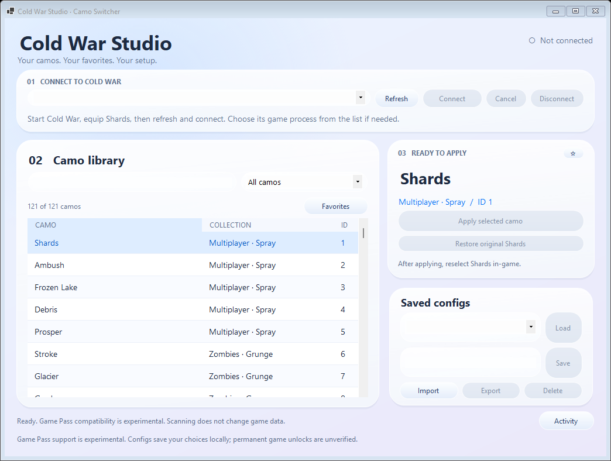
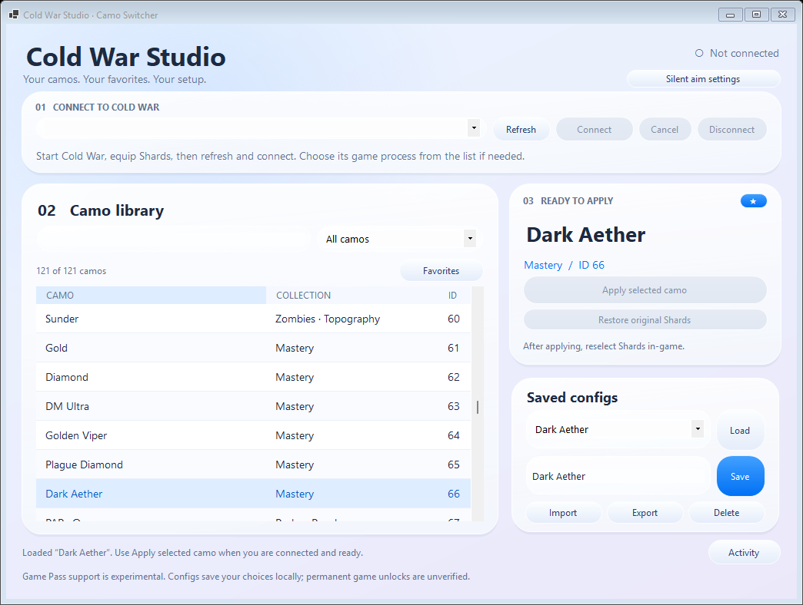

# Cold War Camo Switcher

## Install

Requires Windows 10/11 x64.

1. Download `ColdWarCamoSwitcher-win-x64.zip` from [Releases](https://github.com/ll2Rawll/Cold-war-camo-switcher/releases).
2. Extract the ZIP into a folder.
3. Open `ColdWarCamoSwitcher.exe`. The .NET runtime is included.

## How to use

1. Start Cold War on PC Xbox / Game Pass. Equip **Shards** on your weapon and leave the camo menu open. Shards must already be available on that weapon.
2. In the app, press **Refresh**, select the running game process, and click **Connect**.
3. Search or filter the camo library, choose a camo, and click **Apply selected camo**.
4. Return to the game, select another camo, then reselect **Shards** to refresh the weapon's appearance.
5. When finished, click **Restore original Shards** and **Disconnect**.

To save a local config, choose a camo, enter a name under **Saved configs**, and press **Save**. Select a saved config and press **Load** to prepare it, then **Apply selected camo** when connected. Use **Import** and **Export** to transfer your config library.

Click **☆** to favorite a camo and **Favorites** to show your favorites.

## Preview

